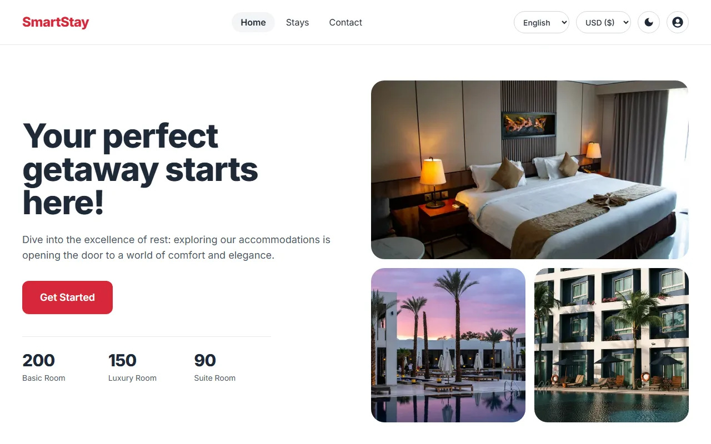
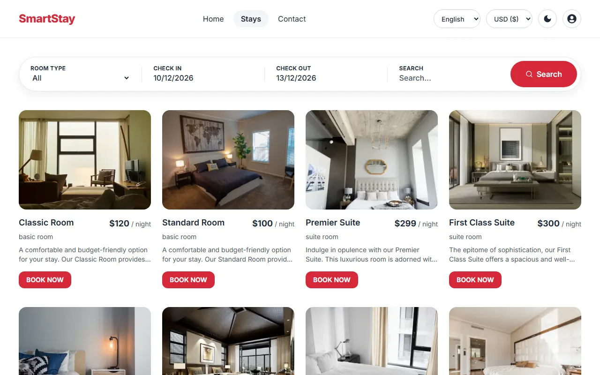
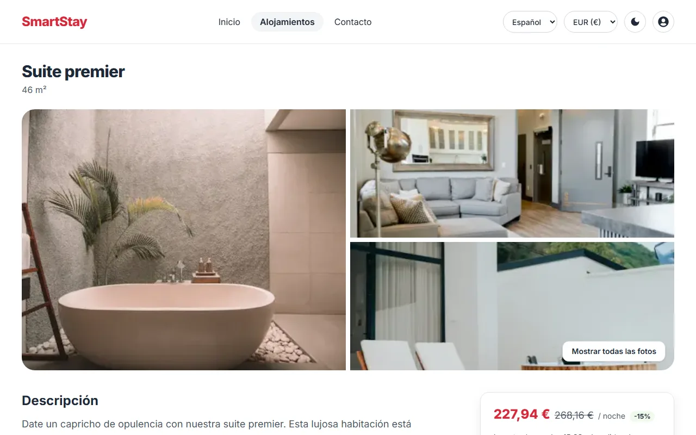
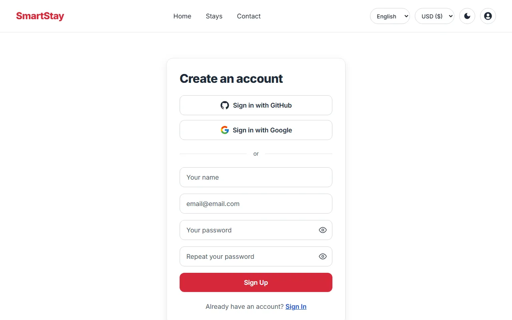
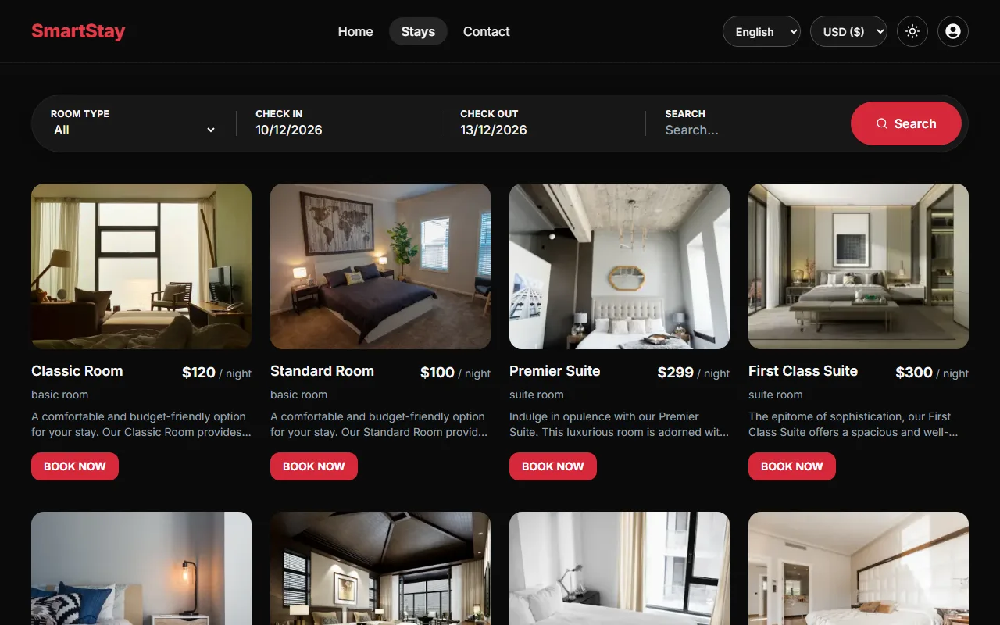
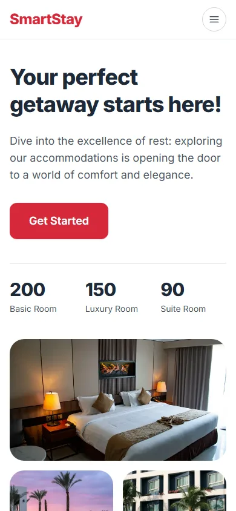
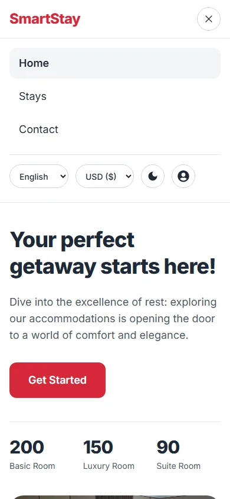
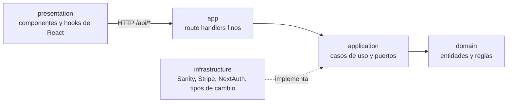

# SmartStay

[English](README.md) | **Español**

**Encuentra tu alojamiento, elige las fechas y resérvalo.**

SmartStay es una aplicación bilingüe de reserva de alojamientos. Quien la visita busca habitaciones por fechas, ve los precios en dólares o en euros y paga con Stripe. Las habitaciones, las reservas y los usuarios se gestionan en un Sanity Studio integrado. La interfaz es responsive, tiene un tema claro y otro oscuro, y se ha comprobado con pruebas automáticas frente a las pautas WCAG 2.2 de nivel AA.

[](https://github.com/srdgz/smartstay/actions/workflows/ci.yml)

**Demo:** [smartstay.vercel.app](https://smartstay.vercel.app). Crea una cuenta con tu correo o entra con GitHub o Google.

## Capturas de pantalla

| Inicio | Búsqueda por fechas |
| --- | --- |
|  |  |

| Habitación y reserva | Español y euros |
| --- | --- |
|  |  |

| Crear una cuenta | Tema oscuro |
| --- | --- |
|  |  |

| Móvil: inicio | Móvil: menú |
| --- | --- |
|  |  |

## Funcionalidades

- **Búsqueda por fechas.** Elige una fecha de llegada y otra de salida y la lista solo muestra las habitaciones libres. Una habitación está libre si ninguna reserva se solapa con la estancia; se puede entrar el mismo día en que otro huésped se va. La página de la habitación conserva las fechas, desactiva las noches ya reservadas y avisa si las fechas chocan.
- **Sin reservas duplicadas.** El servidor vuelve a comprobar la disponibilidad al empezar el pago, y la reserva solo se crea desde el webhook firmado de Stripe.
- **Inglés y español.** El sitio vive bajo `/en` y `/es`, y los nombres, descripciones y servicios de las habitaciones están traducidos en Sanity. La superficie se muestra en pies cuadrados en inglés y en metros cuadrados en español.
- **Dólares y euros.** Los precios siguen la moneda que elijas y Stripe cobra en esa moneda. Los tipos de cambio vienen del Banco Central Europeo, se guardan en caché 12 horas y, si el servicio falla, se usa un tipo configurado. Cada reserva guarda su moneda, el tipo y el importe cobrado.
- **Cuentas.** Regístrate con correo y contraseña (con campo de confirmación y botones para mostrarla u ocultarla), o usa GitHub o Google.
- **Perfil.** Sube o quita tu foto (JPEG, PNG o WebP, hasta 2 MB), consulta tus reservas con sus fechas y su estado (próxima, en curso o finalizada), un gráfico de lo que has gastado y valora las habitaciones que has reservado.
- **Reseñas.** Los huéspedes puntúan una habitación de 1 a 5 estrellas y dejan un comentario.
- **Gestión de contenido.** Las habitaciones, reservas, reseñas y usuarios se editan en Sanity Studio, que se sirve en `/studio`.
- **Diseño responsive** al estilo de las webs de viajes actuales, desde móviles de 320 px hasta pantallas grandes, con tema claro y oscuro.

## Tecnologías

| Capa | Tecnología |
| --- | --- |
| Framework | Next.js 16 (App Router), React 19, TypeScript |
| Estilos | Tailwind CSS |
| Contenido y datos | Sanity (CMS, base de datos y Studio) |
| Autenticación | NextAuth con GitHub, Google y correo y contraseña |
| Pagos | Stripe Checkout y webhooks |
| Internacionalización | next-intl |
| Datos en el cliente | SWR, Axios |
| Pruebas | Vitest, Testing Library, jest-axe |
| Calidad | ESLint (con jsx-a11y), TypeScript |
| CI/CD | GitHub Actions, Vercel |

## Arquitectura

El código sigue una arquitectura limpia: las capas internas no saben nada de las externas. ESLint lo hace cumplir con `no-restricted-imports`, de modo que `domain` no puede importar `application`, `infrastructure`, `presentation` ni ningún framework, y `presentation` no puede llegar directamente al código del servidor.



- **`domain`**: entidades, errores y reglas puras, como el precio por noche con descuentos, la regla de solape de fechas, la validación de la estancia, la conversión de moneda y las reglas del avatar.
- **`application`**: casos de uso creados con factorías (`makeStartCheckout({ rooms, bookings, payments, rates })`) y los puertos que necesitan, como la pasarela de pago y el almacenamiento de avatares.
- **`infrastructure`**: repositorios de Sanity, la pasarela de Stripe, el proveedor de tipos de cambio, la configuración de NextAuth y los ayudantes HTTP. `container.ts` lo conecta todo.
- **`presentation`**: componentes, hooks y utilidades del cliente. El navegador nunca consulta Sanity; llama a las rutas `/api`.
- **`app`**: rutas y páginas de Next.js, lo más finas posible. Las páginas viven en `src/app/[locale]` y el Studio en `/studio`, fuera del idioma.

Los errores llevan un `code` y parámetros, para que la interfaz pueda mostrarlos en el idioma de quien visita.

## Cómo funciona una reserva

1. La persona elige habitación y fechas. El navegador envía la habitación, las fechas, el número de huéspedes y la moneda a `POST /api/checkout`.
2. El servidor lo valida todo, comprueba que la habitación está libre en esas fechas, **calcula él mismo el precio** a partir de la habitación, el descuento y el número de noches, lo convierte a la moneda elegida y crea una sesión de Stripe Checkout. Los precios que envía el navegador nunca se dan por buenos.
3. Se redirige al navegador a la página de Stripe para pagar.
4. Stripe llama a `POST /api/webhook` cuando el pago se completa. El servidor verifica la firma y solo entonces crea la reserva en Sanity.

## Accesibilidad y diseño responsive

- ESLint ejecuta `jsx-a11y` con las reglas estrictas como errores, y los componentes se prueban con jest-axe.
- Una ejecución de axe-core con las reglas WCAG 2.0, 2.1 y 2.2 de nivel A y AA no encontró incumplimientos en las páginas principales (inicio, alojamientos, habitación, contacto, inicio de sesión y registro), en inglés y español, en escritorio y móvil, con los temas claro y oscuro.
- Los textos y controles cumplen las proporciones de contraste, el foco siempre es visible, los formularios tienen etiquetas, los diálogos atrapan el foco y los errores y avisos se anuncian a los lectores de pantalla. Hay un enlace para saltar al contenido y el idioma de la página sigue el del sitio. Los contadores respetan el ajuste de reducir movimiento.
- El diseño se adapta desde 320 px, con un botón de menú por debajo de 1024 px.

Las herramientas automáticas solo detectan una parte de los problemas posibles. Se recomienda una revisión manual con teclado, zoom y lector de pantalla antes de afirmar la conformidad completa.

## Seguridad

- Los precios y las noches se calculan en el servidor a partir de las fechas de la reserva.
- Los webhooks de Stripe se verifican con el secreto de firma, y las reservas solo se crean desde ellos.
- Las rutas de reservas, perfil y reseñas exigen una sesión.
- Las contraseñas se guardan con Argon2, y el formulario de registro pide al menos ocho caracteres.
- Las fotos de perfil se limitan a JPEG, PNG y WebP de hasta 2 MB, y el tipo se detecta por el contenido del archivo, no por su nombre.
- Los secretos viven en variables de entorno. Los archivos `.env` no se versionan.

## Puesta en marcha en local

Necesitas Node 22 o superior, un proyecto de [Sanity](https://www.sanity.io) y una cuenta de [Stripe](https://stripe.com) en modo de pruebas.

```bash
git clone https://github.com/srdgz/smartstay.git
cd smartstay
npm install
```

Crea un archivo `.env.local` en la raíz con las variables de abajo y después:

```bash
npm run dev
```

Abre [http://localhost:3000](http://localhost:3000). El Studio está en [http://localhost:3000/studio](http://localhost:3000/studio).

### Variables de entorno

| Variable | Para qué sirve |
| --- | --- |
| `NEXT_PUBLIC_SANITY_PROJECT_ID` | Proyecto de Sanity |
| `NEXT_PUBLIC_SANITY_DATASET` | Dataset de Sanity, por ejemplo `production` o `development` |
| `SANITY_STUDIO_TOKEN` | Token de Sanity con permiso de escritura, que usa el servidor |
| `STRIPE_SECRET_KEY` | Clave secreta de Stripe (`sk_test_...` en modo de pruebas) |
| `STRIPE_WEBHOOK_SECRET` | Secreto de firma del webhook de Stripe |
| `NEXTAUTH_SECRET` | Clave con la que se firman las sesiones |
| `NEXTAUTH_URL` | URL pública del sitio, `http://localhost:3000` en local |
| `GITHUB_CLIENT_ID`, `GITHUB_CLIENT_SECRET` | Inicio de sesión con GitHub |
| `GOOGLE_CLIENT_ID`, `GOOGLE_CLIENT_SECRET` | Inicio de sesión con Google |
| `FALLBACK_USD_EUR_RATE` | Opcional. Tipo de cambio que se usa si no hay uno en directo. Por defecto `0.92` |

Cosas que hay que configurar:

- **Sanity:** añade `http://localhost:3000` como origen CORS para el Studio. Es mejor usar un dataset `development` aparte mientras pruebas, porque las reservas, los usuarios y las fotos subidas se escriben en el dataset que configures.
- **Stripe:** redirige el webhook a tu equipo con `stripe listen --forward-to localhost:3000/api/webhook` y copia en `STRIPE_WEBHOOK_SECRET` el secreto de firma que muestra. En modo de pruebas puedes pagar con la tarjeta `4242 4242 4242 4242`, cualquier fecha de caducidad futura y cualquier CVC.
- **GitHub y Google:** crea aplicaciones OAuth con `http://localhost:3000/api/auth/callback/github` y `http://localhost:3000/api/auth/callback/google` como URL de retorno.

### Contenido en español

Cada habitación tiene campos opcionales en español en Sanity (nombre, descripción, nota especial y servicios). `scripts/apply-spanish-content.mjs` rellena los que están vacíos a partir de `scripts/rooms.es.json`. Por defecto no escribe nada:

```bash
node scripts/apply-spanish-content.mjs           # muestra lo que escribiría
node scripts/apply-spanish-content.mjs --write   # lo escribe en el dataset configurado
```

## Pruebas y calidad

```bash
npm run lint
npm run typecheck
npm test
```

- **Dominio y aplicación:** precios, solapes de fechas, validación de la estancia, conversión de moneda, pago, reservas completadas, búsqueda de disponibilidad, reseñas y avatares, con dobles en memoria.
- **Infraestructura:** los mapeadores de Sanity, el almacenamiento de avatares, el proveedor de tipos de cambio y las respuestas de error HTTP.
- **Interfaz:** componentes y páginas con Testing Library, con comprobación de accesibilidad con jest-axe, en inglés y español. Otra prueba verifica que los dos archivos de mensajes definen las mismas claves.

## CI/CD y despliegue

- **CI** (`.github/workflows/ci.yml`): en cada push a `master` y a las ramas `feat/**`, `fix/**` y `chore/**`, y en las pull requests, instala las dependencias, pasa el linter, ejecuta las pruebas, compila con variables de entorno de relleno y comprueba los tipos.
- **Vercel** despliega a producción cada push a `master` y crea una vista previa para el resto de ramas.

Para desplegar tu propia copia, importa el repositorio en Vercel, añade las variables de entorno anteriores y configura el webhook de Stripe en `https://tu-dominio/api/webhook` para el evento `checkout.session.completed`. Añade tu dominio como origen CORS en Sanity y como URL de retorno en tus aplicaciones OAuth.

## API

Todas las rutas están bajo `/api`. Las marcadas con un candado necesitan una sesión.

| Ruta | Para qué sirve |
| --- | --- |
| `GET /rooms?locale=&checkin=&checkout=` | Lista las habitaciones. Con fechas, solo las libres |
| `GET /rooms/{slug}?locale=` | Una habitación |
| `GET /rooms/{slug}/availability` | Rangos de fechas reservados de una habitación |
| `GET /room-reviews/{roomId}` | Reseñas de una habitación |
| `POST /reviews` 🔒 | Crea o actualiza tu reseña de una habitación |
| `POST /checkout` 🔒 | Crea una sesión de Stripe Checkout para una estancia |
| `POST /webhook` | Webhook de Stripe que crea la reserva |
| `GET /bookings?locale=` 🔒 | Tus reservas |
| `GET /me` 🔒 | Tu perfil |
| `POST /me/avatar`, `DELETE /me/avatar` 🔒 | Sube o quita tu foto de perfil |
| `POST /sanity/signUp` | Crea una cuenta con correo y contraseña |
| `/auth/*` | NextAuth |

## Estructura del repositorio

```text
messages/              Textos de la interfaz en inglés y español
schemas/               Esquemas de Sanity (habitaciones, reservas, reseñas, usuarios)
scripts/               Contenido de las habitaciones en español y el script que lo aplica
docs/screenshots/      Imágenes que se usan en este README
src/
  domain/              Entidades, errores y reglas puras
  application/         Casos de uso y puertos
  infrastructure/      Adaptadores de Sanity, Stripe, NextAuth y tipos de cambio
  presentation/        Componentes, hooks, contexto y utilidades del cliente
  i18n/                Configuración de next-intl
  app/                 Páginas (bajo [locale]), rutas de la API y el Studio
  proxy.ts             Rutas por idioma y protección de las páginas de perfil
  test/                Utilidades de las pruebas
.github/workflows/     CI
```
