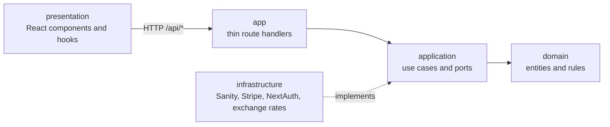

# SmartStay

**English** | [Español](README.es.md)

**Find a stay, pick your dates, book it.**

SmartStay is a bilingual hotel booking app. Visitors search for rooms by dates, see prices in dollars or euros and pay with Stripe. Rooms, bookings and users are managed in an embedded Sanity Studio. The interface is responsive, has a light and a dark theme, and was checked against the WCAG 2.2 level AA guidelines with automated tests.

[](https://github.com/srdgz/smartstay/actions/workflows/ci.yml)

**Demo:** [smartstay.vercel.app](https://smartstay.vercel.app). Create an account with your email, or sign in with GitHub or Google.

## Screenshots

| Home | Search by dates |
| --- | --- |
|  |  |

| Room and booking | Spanish and euros |
| --- | --- |
|  |  |

| Create an account | Dark theme |
| --- | --- |
|  |  |

| Mobile: home | Mobile: menu |
| --- | --- |
|  |  |

## Features

- **Search by dates.** Pick a check-in and a check-out date and the list only shows the rooms that are free. A room is free when no booking overlaps the stay; checking in on the day another guest leaves is allowed. The room page keeps the dates, disables the nights that are already booked and warns if the dates clash.
- **No double bookings.** The server checks the availability again when the payment starts, and the booking is only created from Stripe's signed webhook.
- **English and Spanish.** The site lives under `/en` and `/es`, and the room names, descriptions and amenities are translated in Sanity. Room sizes show square feet in English and square metres in Spanish.
- **Dollars and euros.** Prices follow the currency you choose and Stripe charges in that currency. Exchange rates come from the European Central Bank, are cached for 12 hours and fall back to a configured rate if the service is down. Each booking stores its currency, rate and amount charged.
- **Accounts.** Sign up with email and password (with a confirmation field and show/hide buttons), or use GitHub or Google.
- **Profile.** Upload or remove a profile photo (JPEG, PNG or WebP, up to 2 MB), see your bookings with their dates and status (upcoming, in progress or completed), a chart of what you spent and rate the rooms you booked.
- **Reviews.** Guests rate a room from 1 to 5 stars and leave a comment.
- **Content management.** Rooms, bookings, reviews and users are edited in Sanity Studio, served at `/studio`.
- **Responsive design** in the style of modern travel sites, from 320 px phones to wide desktops, with a light and a dark theme.

## Tech stack

| Layer | Technology |
| --- | --- |
| Framework | Next.js 16 (App Router), React 19, TypeScript |
| Styling | Tailwind CSS |
| Content and data | Sanity (CMS, database and Studio) |
| Authentication | NextAuth with GitHub, Google and email and password |
| Payments | Stripe Checkout and webhooks |
| Internationalization | next-intl |
| Data fetching | SWR, Axios |
| Testing | Vitest, Testing Library, jest-axe |
| Quality | ESLint (including jsx-a11y), TypeScript |
| CI/CD | GitHub Actions, Vercel |

## Architecture

The code follows a clean architecture: inner layers know nothing about outer ones. ESLint enforces it with `no-restricted-imports`, so `domain` cannot import `application`, `infrastructure`, `presentation` or any framework, and `presentation` cannot reach server code directly.



- **`domain`**: entities, errors and pure rules, such as the nightly price with discounts, the date overlap rule, stay validation, currency conversion and the avatar rules.
- **`application`**: use cases built with factories (`makeStartCheckout({ rooms, bookings, payments, rates })`) and the ports they need, such as the payment gateway and the avatar storage.
- **`infrastructure`**: Sanity repositories, the Stripe gateway, the exchange rate provider, the NextAuth options and the HTTP helpers. `container.ts` wires everything together.
- **`presentation`**: components, hooks and client helpers. The browser never queries Sanity; it calls the `/api` routes.
- **`app`**: Next.js routes and pages, kept thin. Pages live under `src/app/[locale]`, and the Studio under `/studio`, outside the locale.

Errors carry a `code` and parameters, so the interface can show them in the visitor's language.

## How a booking works

1. The visitor chooses a room and dates. The browser sends the room, the dates, the number of guests and the currency to `POST /api/checkout`.
2. The server validates everything, checks that the room is free for those dates, **computes the price itself** from the room, the discount and the number of nights, converts it to the chosen currency and creates a Stripe Checkout session. Prices sent by the browser are never trusted.
3. The browser is redirected to the Stripe page to pay.
4. Stripe calls `POST /api/webhook` when the payment completes. The server verifies the signature and only then creates the booking in Sanity.

## Accessibility and responsive design

- ESLint runs `jsx-a11y` with the strict rules as errors, and components are tested with jest-axe.
- An axe-core run with the WCAG 2.0, 2.1 and 2.2 level A and AA rules found no violations on the main pages (home, stays, room, contact, sign in and sign up), in English and Spanish, on desktop and mobile, in the light and dark themes.
- Text and controls meet the colour contrast ratios, focus is always visible, forms have labels, dialogs trap focus and errors and notifications are announced to screen readers. There is a skip link and the page language follows the site language. Counters respect the reduced motion setting.
- The layout adapts from 320 px upwards, with a menu button below 1024 px.

Automated tools find only part of the possible problems. A manual review with a keyboard, zoom and a screen reader is still recommended before claiming full conformance.

## Security

- Prices and nights are computed on the server from the booking dates.
- Stripe webhooks are verified with the signing secret, and bookings are only created from them.
- Bookings, profile and review routes require a session.
- Passwords are hashed with Argon2, and the sign-up form asks for at least eight characters.
- Profile photos are limited to JPEG, PNG and WebP of up to 2 MB, and the type is detected from the file contents, not from its name.
- Secrets live in environment variables. `.env` files are not versioned.

## Getting started locally

You need Node 22 or later, a [Sanity](https://www.sanity.io) project and a [Stripe](https://stripe.com) account in test mode.

```bash
git clone https://github.com/srdgz/smartstay.git
cd smartstay
npm install
```

Create a `.env.local` file in the root with the variables below, then:

```bash
npm run dev
```

Open [http://localhost:3000](http://localhost:3000). The Studio is at [http://localhost:3000/studio](http://localhost:3000/studio).

### Environment variables

| Variable | Purpose |
| --- | --- |
| `NEXT_PUBLIC_SANITY_PROJECT_ID` | Sanity project |
| `NEXT_PUBLIC_SANITY_DATASET` | Sanity dataset, for example `production` or `development` |
| `SANITY_STUDIO_TOKEN` | Sanity token with write access, used by the server |
| `STRIPE_SECRET_KEY` | Stripe secret key (`sk_test_...` in test mode) |
| `STRIPE_WEBHOOK_SECRET` | Signing secret of the Stripe webhook |
| `NEXTAUTH_SECRET` | Key used to sign the sessions |
| `NEXTAUTH_URL` | Public URL of the site, `http://localhost:3000` locally |
| `GITHUB_CLIENT_ID`, `GITHUB_CLIENT_SECRET` | GitHub sign in |
| `GOOGLE_CLIENT_ID`, `GOOGLE_CLIENT_SECRET` | Google sign in |
| `FALLBACK_USD_EUR_RATE` | Optional. Exchange rate used if the live rate is unavailable. Defaults to `0.92` |

A few things to set up:

- **Sanity:** add `http://localhost:3000` as a CORS origin for the Studio. Prefer a separate `development` dataset while you test, because bookings, users and uploaded photos are written to the dataset you configure.
- **Stripe:** forward the webhook to your machine with `stripe listen --forward-to localhost:3000/api/webhook` and copy the signing secret it prints into `STRIPE_WEBHOOK_SECRET`. In test mode you can pay with the card `4242 4242 4242 4242`, any future expiry date and any CVC.
- **GitHub and Google:** create OAuth apps with `http://localhost:3000/api/auth/callback/github` and `http://localhost:3000/api/auth/callback/google` as callback URLs.

### Spanish content

Each room has optional Spanish fields in Sanity (name, description, special note and amenities). `scripts/apply-spanish-content.mjs` fills the empty ones from `scripts/rooms.es.json`. It is a dry run by default:

```bash
node scripts/apply-spanish-content.mjs           # shows what it would write
node scripts/apply-spanish-content.mjs --write   # writes it to the configured dataset
```

## Tests and quality

```bash
npm run lint
npm run typecheck
npm test
```

- **Domain and application:** pricing, date overlaps, stay validation, currency conversion, checkout, completed bookings, availability search, reviews and avatars, using in-memory fakes.
- **Infrastructure:** the Sanity mappers, the avatar storage, the exchange rate provider and the HTTP error responses.
- **Interface:** components and pages with Testing Library, checked for accessibility with jest-axe, in English and Spanish. A test also checks that both message files define the same keys.

## CI/CD and deployment

- **CI** (`.github/workflows/ci.yml`): on every push to `master`, `feat/**`, `fix/**` and `chore/**` branches and on pull requests, it installs the dependencies, lints, runs the tests, builds with placeholder environment variables and type-checks.
- **Vercel** deploys every push to `master` to production and creates a preview for every other branch.

To deploy your own copy, import the repository into Vercel, add the environment variables above and set the Stripe webhook to `https://your-domain/api/webhook` for the `checkout.session.completed` event. Add your domain as a CORS origin in Sanity and as a callback URL in your OAuth apps.

## API

All routes live under `/api`. Routes marked with a lock need a session.

| Route | Purpose |
| --- | --- |
| `GET /rooms?locale=&checkin=&checkout=` | List the rooms. With dates, only the free ones |
| `GET /rooms/{slug}?locale=` | One room |
| `GET /rooms/{slug}/availability` | Booked date ranges of a room |
| `GET /room-reviews/{roomId}` | Reviews of a room |
| `POST /reviews` 🔒 | Create or update your review of a room |
| `POST /checkout` 🔒 | Create a Stripe Checkout session for a stay |
| `POST /webhook` | Stripe webhook that creates the booking |
| `GET /bookings?locale=` 🔒 | Your bookings |
| `GET /me` 🔒 | Your profile |
| `POST /me/avatar`, `DELETE /me/avatar` 🔒 | Upload or remove your profile photo |
| `POST /sanity/signUp` | Create an account with email and password |
| `/auth/*` | NextAuth |

## Repository structure

```text
messages/              Interface texts in English and Spanish
schemas/               Sanity schemas (rooms, bookings, reviews, users)
scripts/               Spanish room content and the script that applies it
docs/screenshots/      Images used in this README
src/
  domain/              Entities, errors and pure rules
  application/         Use cases and ports
  infrastructure/      Sanity, Stripe, NextAuth and exchange rate adapters
  presentation/        Components, hooks, context and client helpers
  i18n/                next-intl configuration
  app/                 Pages (under [locale]), API routes and the Studio
  proxy.ts             Locale routing and protection of the profile pages
  test/                Test helpers
.github/workflows/     CI
```
